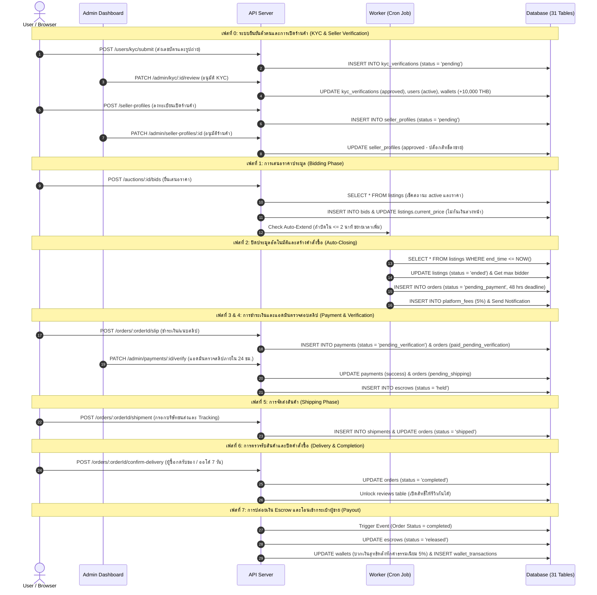

# ERD (เจ้าของ: SA)

SA วางไฟล์ในโฟลเดอร์นี้:

- `schema.sql` โครงสร้างตารางทั้งระบบ (CREATE TABLE) **ไฟล์หลักที่ AI และทุกคนอ้างอิง**
- `erd.png` หรือ `erd.pdf` รูปแผนผังสำหรับส่งอาจารย์

กติกา:

- ชื่อตารางและคอลัมน์ใช้ `snake_case` ชื่อตารางเป็นพหูพจน์ เช่น `users`, `listings`, `bids`
- ทุกตารางมี `id` (BIGINT AUTO_INCREMENT), `created_at`, `updated_at`
- เวลาเก็บเป็น UTC (`DATETIME`) เงินเก็บเป็น `DECIMAL(12,2)` ห้ามใช้ FLOAT
- สถานะเก็บเป็นค่าภาษาอังกฤษตัวเล็ก เช่น `pending_verification` ส่วนชื่อภาษาไทยแปลงที่ฝั่ง FE
- สถานะบัญชีต้องตรงกับ D-03 ใน `docs/decision-log.md`

ตารางที่อย่างน้อยต้องมี (จากแผนงานรายเฟส): users, user_consents, otp_codes, password_resets, sessions, addresses, seller_profiles, categories, listings, listing_images, bids, proxy_bids, watchlists, orders, payments, wallets, wallet_transactions, escrows, shipments, disputes, dispute_evidence, penalties, blacklists, notifications, notification_settings, admin_audit_logs, system_settings

## Sequence Diagram

### 1. โครงสร้างระบบ (Actors & Components)
1. **`User`** (ฝั่งผู้ใช้: ผู้ซื้อ/ผู้ขาย)
2. **`Admin`** (ฝั่งแอดมิน)
3. **`API Server`** (หลังบ้าน / Backend Controller)
4. **`Worker`** (ระบบรันอัตโนมัติเบื้องหลัง เช่น เช็คเวลาหมดประมูล)
5. **`Database`** (ฐานข้อมูลหลักของระบบ)

### 2. ลำดับขั้นตอนการทำงานของระบบ (Sequence Flow)

---

## Database ER Diagram (31 Tables)

```mermaid
erDiagram
    users {
        string id PK "VARCHAR(36) UUID"
        string email UK "VARCHAR(150)"
        string username UK "VARCHAR(50)"
        string phone UK "VARCHAR(20)"
        string password_hash "VARCHAR(255)"
        string full_name "VARCHAR(100)"
        string role "ENUM"
        string account_status "ENUM"
        timestamp status_expired_at "Nullable"
        boolean is_phone_verified "Default: FALSE"
        timestamp created_at
        timestamp updated_at
    }

    user_consents {
        int id PK "Auto Increment"
        string user_id FK "VARCHAR(36)"
        string consent_type "VARCHAR(50)"
        boolean is_accepted
        string version "VARCHAR(20)"
        string ip_address "VARCHAR(45)"
        timestamp created_at
    }

    otp_codes {
        int id PK "Auto Increment"
        string user_id FK "Nullable"
        string phone "VARCHAR(20)"
        string otp_hash "VARCHAR(255)"
        timestamp expires_at
        boolean is_used
        int attempts
        timestamp created_at
    }

    password_resets {
        int id PK "Auto Increment"
        string user_id FK "VARCHAR(36)"
        string token_hash "VARCHAR(255)"
        timestamp expires_at
        boolean is_used
        timestamp created_at
    }

    sessions {
        string id PK "UUID"
        string user_id FK "VARCHAR(36)"
        string refresh_token_hash "VARCHAR(255)"
        string ip_address "VARCHAR(45)"
        text user_agent
        timestamp expires_at
        timestamp created_at
    }

    addresses {
        int id PK "Auto Increment"
        string user_id FK "VARCHAR(36)"
        string recipient_name "VARCHAR(100)"
        string phone "VARCHAR(20)"
        text address_line
        string sub_district "VARCHAR(100)"
        string district "VARCHAR(100)"
        string province "VARCHAR(100)"
        string postal_code "VARCHAR(10)"
        boolean is_default
        timestamp created_at
    }

    seller_profiles {
        int id PK "Auto Increment"
        string user_id FK "UK, VARCHAR(36)"
        string store_name "VARCHAR(150)"
        text store_description
        string verification_status "ENUM"
        string bank_account_name "VARCHAR(150)"
        string bank_account_number "VARCHAR(50)"
        string bank_name "VARCHAR(50)"
        timestamp created_at
    }

    categories {
        int id PK "Auto Increment"
        int parent_id FK "Nullable"
        string category_name "VARCHAR(100)"
        string slug UK "VARCHAR(120)"
        timestamp created_at
    }

    listings {
        int id PK "Auto Increment"
        string seller_id FK "VARCHAR(36)"
        int category_id FK
        string title "VARCHAR(200)"
        text description
        string franchise_name "VARCHAR(150)"
        string item_condition "ENUM"
        boolean is_official
        boolean is_blind_box
        decimal start_price "DECIMAL(12,2)"
        decimal current_price "DECIMAL(12,2)"
        decimal bid_increment "DECIMAL(12,2)"
        decimal reserve_price "DECIMAL(12,2)"
        decimal buy_now_price "DECIMAL(12,2)"
        string status "ENUM"
        timestamp start_time
        timestamp end_time
        int extend_count
        timestamp created_at
    }

    listing_images {
        int id PK "Auto Increment"
        int listing_id FK
        string image_url "VARCHAR(255)"
        boolean is_primary
        int sort_order
        timestamp created_at
    }

    bids {
        int id PK "Auto Increment"
        int listing_id FK
        string bidder_id FK "VARCHAR(36)"
        decimal bid_amount "DECIMAL(12,2)"
        string bid_type "ENUM"
        timestamp created_at
    }

    proxy_bids {
        int id PK "Auto Increment"
        int listing_id FK
        string bidder_id FK "VARCHAR(36)"
        decimal max_amount "DECIMAL(12,2)"
        boolean is_active
        timestamp created_at
    }

    watchlists {
        int id PK "Auto Increment"
        string user_id FK "VARCHAR(36)"
        int listing_id FK
        timestamp created_at
    }

    orders {
        int id PK "Auto Increment"
        int listing_id FK "UK"
        string buyer_id FK "VARCHAR(36)"
        string seller_id FK "VARCHAR(36)"
        decimal final_amount "DECIMAL(12,2)"
        decimal platform_fee "DECIMAL(12,2)"
        string closing_type "ENUM"
        text shipping_address_snapshot
        string status "ENUM"
        timestamp created_at
    }

    payments {
        int id PK "Auto Increment"
        int order_id FK
        string payer_id FK "VARCHAR(36)"
        decimal amount "DECIMAL(12,2)"
        string payment_method "ENUM"
        string slip_image_url "VARCHAR(255)"
        string status "ENUM"
        string verified_by FK "VARCHAR(36)"
        timestamp created_at
    }

    wallets {
        int id PK "Auto Increment"
        string user_id FK "UK, VARCHAR(36)"
        decimal available_balance "DECIMAL(12,2)"
        timestamp created_at
    }

    wallet_transactions {
        int id PK "Auto Increment"
        int wallet_id FK
        string type "ENUM"
        decimal amount "DECIMAL(12,2)"
        decimal balance_before "DECIMAL(12,2)"
        decimal balance_after "DECIMAL(12,2)"
        string reference_id "VARCHAR(50)"
        timestamp created_at
    }

    escrows {
        int id PK "Auto Increment"
        int order_id FK "UK"
        decimal amount "DECIMAL(12,2)"
        string status "ENUM"
        timestamp released_at
        timestamp created_at
    }

    shipments {
        int id PK "Auto Increment"
        int order_id FK "UK"
        string courier_name "VARCHAR(100)"
        string tracking_number "VARCHAR(100)"
        string status "ENUM"
        timestamp shipped_at
        timestamp delivered_at
        timestamp created_at
    }

    disputes {
        int id PK "Auto Increment"
        int order_id FK
        string opener_id FK "VARCHAR(36)"
        string reason "VARCHAR(100)"
        text description
        string status "ENUM"
        string resolution_result "VARCHAR(100)"
        string resolved_by FK "VARCHAR(36)"
        timestamp created_at
    }

    dispute_evidence {
        int id PK "Auto Increment"
        int dispute_id FK
        string uploader_id FK "VARCHAR(36)"
        string file_url "VARCHAR(255)"
        string file_type "VARCHAR(50)"
        timestamp created_at
    }

    dispute_messages {
        int id PK "Auto Increment"
        int dispute_id FK
        string sender_id FK "VARCHAR(36)"
        text message
        timestamp created_at
    }

    penalties {
        int id PK "Auto Increment"
        string user_id FK "VARCHAR(36)"
        string reason "VARCHAR(150)"
        int penalty_points
        timestamp expires_at
        timestamp created_at
    }

    blacklists {
        int id PK "Auto Increment"
        string user_id FK "UK, VARCHAR(36)"
        text reason
        string banned_by FK "VARCHAR(36)"
        timestamp created_at
    }

    notifications {
        int id PK "Auto Increment"
        string user_id FK "VARCHAR(36)"
        string title "VARCHAR(150)"
        text message
        string reference_id "VARCHAR(50)"
        boolean is_read
        timestamp created_at
    }

    notification_settings {
        int id PK "Auto Increment"
        string user_id FK "UK, VARCHAR(36)"
        boolean enable_push
        boolean enable_sms
        boolean enable_email
        timestamp created_at
    }

    admin_audit_logs {
        int id PK "Auto Increment"
        string admin_id FK "VARCHAR(36)"
        string action "VARCHAR(100)"
        string target_type "VARCHAR(50)"
        string target_id "VARCHAR(50)"
        string ip_address "VARCHAR(45)"
        timestamp created_at
    }

    system_settings {
        int id PK "Auto Increment"
        string key_name UK "VARCHAR(100)"
        text key_value
        text description
        timestamp updated_at
    }

    platform_fees {
        int id PK "Auto Increment"
        int order_id FK "UK"
        decimal fee_percentage "DECIMAL(5,2)"
        decimal fee_amount "DECIMAL(12,2)"
        boolean min_fee_applied
        timestamp collected_at
    }

    kyc_verifications {
        int id PK "Auto Increment"
        string user_id FK "UK, VARCHAR(36)"
        string id_card_number_hash "VARCHAR(255)"
        string id_card_image_url "VARCHAR(255)"
        string status "ENUM"
        string reviewed_by FK "VARCHAR(36)"
        text rejection_reason
        timestamp created_at
    }

    reviews {
        int id PK "Auto Increment"
        int order_id FK
        string reviewer_id FK "VARCHAR(36)"
        string reviewee_id FK "VARCHAR(36)"
        int rating
        text comment
        string status "ENUM"
        timestamp created_at
    }

    %% Relationships
    users ||--o{ user_consents : has
    users ||--o{ otp_codes : requests
    users ||--o{ password_resets : requests
    users ||--o{ sessions : has
    users ||--o{ addresses : saves
    users ||--|| seller_profiles : owns
    users ||--o{ listings : creates
    categories ||--o{ categories : subcategories
    categories ||--o{ listings : categorizes
    listings ||--o{ listing_images : contains
    listings ||--o{ bids : receives
    users ||--o{ bids : places
    listings ||--o{ proxy_bids : has
    users ||--o{ proxy_bids : sets
    users ||--o{ watchlists : bookmarks
    listings ||--o{ watchlists : bookmarked_by
    listings ||--|| orders : generates
    users ||--o{ orders : buys_or_sells
    orders ||--o{ payments : has
    users ||--o{ payments : pays_or_verifies
    users ||--|| wallets : has
    wallets ||--o{ wallet_transactions : records
    orders ||--|| escrows : secures
    orders ||--|| shipments : tracks
    orders ||--o{ disputes : reports
    disputes ||--o{ dispute_evidence : includes
    disputes ||--o{ dispute_messages : contains
    users ||--o{ disputes : opens_or_resolves
    users ||--o{ penalties : receives
    users ||--|| blacklists : banned_as
    users ||--o{ blacklists : bans
    users ||--o{ notifications : receives
    users ||--|| notification_settings : configures
    users ||--o{ admin_audit_logs : logs
    orders ||--|| platform_fees : yields
    users ||--o{ kyc_verifications : submits_or_reviews
    orders ||--o{ reviews : receives
    users ||--o{ reviews : writes_or_receives
```

